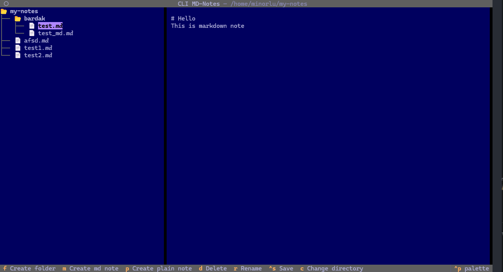

# CLI MD Notes
## About
CLI MD Notes is a note editor that is used to:
- Create and edit plain-text and markdown notes
- Organize your notes into folders
- Provide a tool that doesn't take up much hard drive space



### Built with
- [Python 3.15](https://www.python.org/downloads/release/python-3150/)
- [Textual framework](https://textual.textualize.io/)


## Getting Started
### Prerequisites
- linux or wsl
- uv 0.12+
- git

### Installation
First, you'll need to clone this repository to your computer:

```sh
git clone https://github.com/minorlu/cli-md-notes.git
```

Navigate to the cloned repository and sync project dependencies:

```sh
cd cli-md-notes/
uv sync
```

### Usage
#### Launching
Once all the necessary prerequisites have been met, launch the application:

```sh
uv run cli-md-notes
```
**The application should only be launched from the root folder of cli-md-notes**

#### First launch
If you're launching the app for the first time, the first thing you'll need to do is select a directory that will serve as the root directory for your notes. The selected directory's path will be saved in `conf.json`.

To create a new note, press `M` for a markdown note and `P` for a plain-text note. Then in the input field that appears, enter a note name and press `Enter`

To create a new folder, press `F`. Then in the input field that appears, enter a folder name and press `Enter`

#### Hotkeys
| Key      | Action                    |
| -------- | ------------------------- |
| Arrows   | File tree navigation      |
| Space    | Expand/collapse directory |
| Enter    | Select file/directory     |
| Tab      | Change widget focus       |
| F        | Create folder             |
| M        | Create markdown note      |
| P        | Create plain-text note    |
| D        | Delete note/folder        |
| Ctrl + S | Save the current note     |
| C        | Change root directory     |
| Ctrl + Q | Quit the app              |

> All hotkeys except `Ctrl+S`, `Ctrl+Q` and `Tab` are available only when you are focused on the notes tree. If you are in the "Change directory" mode - only `Tab`, `Arrows`, `Space`, `Enter` and `Ctrl+Q` are available.

## License
This project is licensed under the MIT license. Feel free to modify and distribute this project as you like.

See [LICENSE](./LICENSE) for more information.
